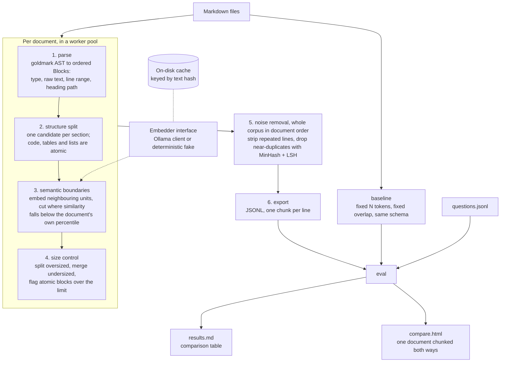

# SmartChunk

A structure-aware chunking engine for RAG, written in Go.

It reads Markdown files and writes clean JSONL chunks that any vector database can ingest. It also ships an evaluation that runs it against a naive fixed-size splitter on real documentation and reports the difference.

## What it does

A fixed-size splitter counts tokens and cuts. It will cut a code block in half, separate a table from its header row, and leave a heading at the bottom of one chunk with its content at the top of the next.

SmartChunk parses the document first and cuts only where the document allows it:

- A code block, table or list is never cut. One that is too big on its own stays whole and is flagged `oversized`.
- A heading always stays with the content below it.
- Inside a long section, cuts go where the topic shifts, found by embedding neighbouring passages and looking for dips in similarity.
- Chunks that are too small are merged into the most closely related neighbour. Prose that is too long is split at sentence boundaries.
- Lines repeated across many chunks (footers, navigation) are stripped, and near-duplicate chunks are dropped.
- Every chunk records where it came from: file, line range, heading path.

## Quick start

Requirements: Go 1.22 or newer. The semantic stage and the evaluation use [Ollama](https://ollama.com) with the `all-minilm` model.

Install the CLI:

```bash
go install github.com/akshatdalakoti-stack/smartchunk/cmd/smartchunk@latest
```

Or build from a clone:

```bash
git clone https://github.com/akshatdalakoti-stack/smartchunk.git
```

```bash
cd smartchunk && go build -o bin/smartchunk ./cmd/smartchunk
```

```bash
ollama pull all-minilm
```

Chunk a directory of Markdown:

```bash
bin/smartchunk run docs/ --out chunks.jsonl
```

No Ollama? Skip the semantic stage and use structure and size control only:

```bash
bin/smartchunk run docs/ --out chunks.jsonl --embedder none
```

Run the evaluation (downloads the corpus on first use):

```bash
make eval
```

## Output

One JSON object per line:

```json
{
  "id": "a540b23354dd297d",
  "text": "## Install from a release\n\nDownload the archive ...\n\n```sh\ncurl -LO ...\n```",
  "chunk_type": "mixed",
  "heading_path": ["Installing Tidepool", "Install from a release"],
  "source_file": "guide/install.md",
  "start_line": 24,
  "end_line": 35,
  "token_count": 106,
  "flags": ["boilerplate_stripped"]
}
```

| Field | Meaning |
|---|---|
| `id` | Stable 16-hex-character hash of source file, line range and text. Same input, same id. |
| `text` | Raw Markdown from the source, blocks separated by blank lines. |
| `chunk_type` | `code`, `table`, `prose` or `mixed`. Headings are ignored when classifying; lists and blockquotes count as prose. |
| `heading_path` | The deepest chain of headings shared by everything in the chunk. |
| `source_file` | Path relative to the input directory, always with forward slashes. |
| `start_line`, `end_line` | 1-based, inclusive line range in the source file. |
| `token_count` | Tokens in `text`, by the built-in approximate tokenizer. |
| `flags` | `oversized`, `sentence_split`, `undersized`, `boilerplate_stripped`. |

## Architecture



### Packages

```
cmd/smartchunk      CLI: run, baseline, eval
internal/parse      goldmark AST -> []Block
internal/split      structural grouping, Candidate type
internal/semantic   embedding-based boundaries, percentile
internal/sizing     split oversized, merge undersized, sentence splitter
internal/dedup      MinHash, LSH index, repeated-line stripping
internal/export     JSONL writer and reader, embedding text
internal/baseline   naive fixed-size splitter
internal/eval       metrics, cosine search, results.md, compare.html
internal/embed      Embedder interface, Ollama client, disk cache, fake, vector maths
internal/chunk      shared Chunk type and Tokenizer interface
internal/pipeline   stage orchestration and the worker pool
```

`chunk` holds the two types every package needs, which avoids import cycles. `pipeline` gives the stage wiring a home that tests and benchmarks can call without going through the CLI.

The only dependency outside the standard library is `github.com/yuin/goldmark`, used for the Markdown AST. MinHash, LSH, cosine similarity, vector search, sentence splitting and token counting are implemented here.

## CLI

```
smartchunk run <path> --out chunks.jsonl [flags]
smartchunk baseline <path> --out baseline.jsonl [flags]
smartchunk eval --corpus <dir> --questions q.jsonl --out report/ [flags]
```

`<path>` is a Markdown file or a directory (walked recursively for `.md` and `.markdown`, skipping hidden directories and `node_modules`). Flags may come before or after the path. `--out -` writes to standard output.

| Flag | Commands | Default | Meaning |
|---|---|---|---|
| `--max-tokens` | run, eval | 256 | Largest chunk. |
| `--min-tokens` | run, eval | 64 | Chunks below this are merged into a neighbour. `0` turns merging off. |
| `--dedup-threshold` | run, eval | 0.85 | Jaccard similarity at which a chunk is dropped as a near-duplicate. `0` keeps duplicates. |
| `--percentile` | run, eval | 25 | Cut where neighbour similarity is below this percentile of the document. |
| `--workers` | all | CPU count | Documents processed at once. |
| `--embedder` | run, eval | `ollama` | `ollama`, `fake` (deterministic, for tests) or, for `run`, `none`. |
| `--ollama-url` | run, eval | `http://localhost:11434` | Ollama server. |
| `--model` | run, eval | `all-minilm` | Embedding model. |
| `--cache-dir` | run, eval | user cache dir | Where `embeddings.bin` lives. |
| `--no-cache` | run, eval | off | Bypass the embedding cache. |
| `--size`, `--overlap` | baseline, eval | 256, 32 | Baseline window and overlap. |
| `--compare-doc` | eval | automatic | Document shown in `compare.html`. |
| `--no-heading-context` | eval | off | Embed bare chunk text (ablation). |
| `--no-semantic` | eval | off | Run SmartChunk without the semantic stage (ablation). |

Exit codes: `0` success, `1` runtime error, `2` usage error. Output order is the same on every run regardless of `--workers`.

## Design decisions

**Blocks are the smallest unit, and their text is the raw source.** The parser emits one `Block` per top-level Markdown node. A chunk is always a run of whole blocks (or, for long prose only, sentence-aligned pieces of one). That makes "never cut a code block, table or list" a property of the data structure rather than a rule each stage has to remember. Block text is copied from the source by line range, not re-rendered from the AST, so fences, list markers and table pipes survive exactly.

**Line ranges are derived, then checked.** goldmark records where a node's content is, not where its syntax ends: the closing fence of a code block, the underline of a setext heading and a table's delimiter row belong to no node. The parser extends each block over those. A table written directly under a line of text reports the paragraph's position as its own, which is corrected. A test runs the parser over the whole evaluation corpus and asserts that every block's text equals the source lines it claims and that no two blocks overlap.

**YAML front matter is blanked, not removed.** Left in, `title: x` followed by `---` parses as a setext heading and pollutes every heading path. It is replaced with empty lines so line numbers do not shift.

**Units keep an explanation with the thing it explains.** Between "section" and "block" there is a middle grouping: a prose block plus the code, tables and lists that directly follow it. Semantic cuts and size splits prefer unit boundaries, so "run this command:" is not separated from the command.

**Semantic boundaries use the document's own distribution.** A fixed similarity threshold would over-cut a rambling tutorial and never cut a tight reference page. Instead every neighbouring pair of units in a document is scored, and cuts go below the 25th percentile of those scores. Documents with fewer than four pairs are left alone, and a small epsilon stops a document whose joins are all equal from being cut on float32 rounding noise. Headings are hard boundaries; semantic cuts only happen inside a section.

**Each boundary remembers how strong it was.** A candidate carries whether the boundary in front of it is structural or semantic and how similar it is to its predecessor. When a chunk is too small, the merge goes across the weakest boundary: same heading path first, then same section, then higher similarity.

**Size control splits before it merges, and packs evenly.** An oversized candidate is cut between units, then between blocks, then (prose only) at sentence boundaries, then at line breaks, then between tokens as a last resort. Packing aims for equal parts instead of filling each chunk to the limit and leaving a scrap. A short lead-in directly in front of an oversized block rides along with it, since the block is over the limit either way and the lead-in gives it context.

**Noise removal sees the whole corpus.** A footer is only a footer because it repeats. Stages 1 to 4 run per document in parallel; stage 5 runs once, over all candidates in document order. A line is boilerplate if it appears in at least 5 chunks and at least 5% of all chunks, and only prose is examined (otherwise ` ``` ` would be the most common "footer" in any corpus). For near-duplicates the first occurrence is kept, so the result does not depend on scheduling.

**MinHash banding is chosen from the threshold.** Signatures are 128 hashes over 3-word shingles of lowercased words. With `b` bands of `r` rows a pair of similarity `s` becomes a candidate with probability `1-(1-s^r)^b`. The index picks the widest rows that keep the steep part of that curve 0.1 below the threshold: for 0.85 that is 16 bands of 8 rows, which catches a pair at the threshold 99.4% of the time while discarding most unrelated pairs before the full comparison.

**The tokenizer is an approximation behind an interface.** A run of letters and digits is one token, a run of the same punctuation character is one token, any other punctuation character is a token. Counting `|-----|` as one token per dash made every table look oversized, which is why repeated punctuation collapses. It undercounts English prose against a subword tokenizer by roughly 20 to 30%. Swap in a real one by implementing `chunk.Tokenizer`.

**The embedding cache is one append-only file.** Records are a SHA-256 of model name and text, a dimension, and the vector. One file instead of one file per text keeps a synced or scanned directory quiet. A torn final record from an interrupted run is detected and truncated on the next open. The cache lives in the user cache directory, not in the project.

**Embedding text is built at export, not baked into the chunk.** `text` stays raw source so line ranges remain true. `export.EmbeddingText` prepends the heading path as a one-line breadcrumb, minus the chunk's own heading if it starts with one. A chunk cut from the middle of a section has no heading of its own, and the breadcrumb is what tells a small embedding model what it is about. The evaluation uses this for both splitters; the baseline has no heading path, so its chunks are embedded as plain text. That is the point: structure awareness is what makes the breadcrumb available. The effect is measured separately below.

**The evaluation judges both splitters by the same ruler.** Structural metrics compare each chunk's line range with one parse of the source document. Nothing is taken from SmartChunk's own bookkeeping, so the same code scores any chunker's JSONL.

**Library code does not panic.** Errors are wrapped with the stage and the file they came from. A panic inside the third-party parser is recovered and returned as an error. Embedding calls take a `context.Context`; cancelling stops the worker pool.
