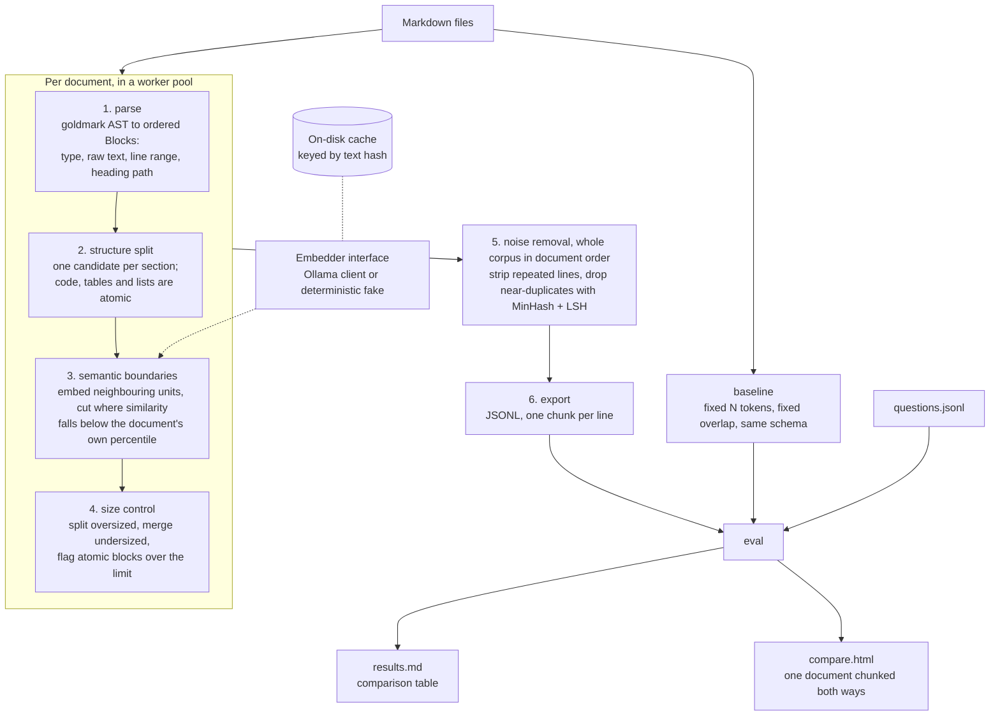

# SmartChunk

A structure-aware chunking engine for RAG, written in Go.

It reads Markdown files and writes clean JSONL chunks that any vector database can ingest. It also ships an evaluation that runs it against a naive fixed-size splitter on real documentation and reports the difference.

## What it does

A fixed-size splitter counts tokens and cuts. It will cut a code block in half, separate a table from its header row, and leave a heading at the bottom of one chunk with its content at the top of the next.

SmartChunk parses the document first and cuts only where the document allows it:

- A code block, table or list is never cut. One that is too big on its own stays whole and is flagged `oversized`.
- A heading always stays with the content below it.
- Inside a long section, cuts go where the topic shifts, found by embedding neighbouring passages and looking for dips in similarity.
- Chunks that are too small are merged into the most closely related neighbour. Prose that is too long is split at sentence boundaries.
- Lines repeated across many chunks (footers, navigation) are stripped, and near-duplicate chunks are dropped.
- Every chunk records where it came from: file, line range, heading path.

## Quick start

Requirements: Go 1.22 or newer. The semantic stage and the evaluation use [Ollama](https://ollama.com) with the `all-minilm` model.

Install the CLI:

```bash
go install github.com/akshatdalakoti-stack/smartchunk/cmd/smartchunk@latest
```

Or build from a clone:

```bash
git clone https://github.com/akshatdalakoti-stack/smartchunk.git
```

```bash
cd smartchunk && go build -o bin/smartchunk ./cmd/smartchunk
```

```bash
ollama pull all-minilm
```

Chunk a directory of Markdown:

```bash
bin/smartchunk run docs/ --out chunks.jsonl
```

No Ollama? Skip the semantic stage and use structure and size control only:

```bash
bin/smartchunk run docs/ --out chunks.jsonl --embedder none
```

Run the evaluation (downloads the corpus on first use):

```bash
make eval
```

## Output

One JSON object per line:

```json
{
  "id": "a540b23354dd297d",
  "text": "## Install from a release\n\nDownload the archive ...\n\n```sh\ncurl -LO ...\n```",
  "chunk_type": "mixed",
  "heading_path": ["Installing Tidepool", "Install from a release"],
  "source_file": "guide/install.md",
  "start_line": 24,
  "end_line": 35,
  "token_count": 106,
  "flags": ["boilerplate_stripped"]
}
```

| Field | Meaning |
|---|---|
| `id` | Stable 16-hex-character hash of source file, line range and text. Same input, same id. |
| `text` | Raw Markdown from the source, blocks separated by blank lines. |
| `chunk_type` | `code`, `table`, `prose` or `mixed`. Headings are ignored when classifying; lists and blockquotes count as prose. |
| `heading_path` | The deepest chain of headings shared by everything in the chunk. |
| `source_file` | Path relative to the input directory, always with forward slashes. |
| `start_line`, `end_line` | 1-based, inclusive line range in the source file. |
| `token_count` | Tokens in `text`, by the built-in approximate tokenizer. |
| `flags` | `oversized`, `sentence_split`, `undersized`, `boilerplate_stripped`. |

## Architecture



### Packages

```
cmd/smartchunk      CLI: run, baseline, eval
internal/parse      goldmark AST -> []Block
internal/split      structural grouping, Candidate type
internal/semantic   embedding-based boundaries, percentile
internal/sizing     split oversized, merge undersized, sentence splitter
internal/dedup      MinHash, LSH index, repeated-line stripping
internal/export     JSONL writer and reader, embedding text
internal/baseline   naive fixed-size splitter
internal/eval       metrics, cosine search, results.md, compare.html
internal/embed      Embedder interface, Ollama client, disk cache, fake, vector maths
internal/chunk      shared Chunk type and Tokenizer interface
internal/pipeline   stage orchestration and the worker pool
```

`chunk` holds the two types every package needs, which avoids import cycles. `pipeline` gives the stage wiring a home that tests and benchmarks can call without going through the CLI.

The only dependency outside the standard library is `github.com/yuin/goldmark`, used for the Markdown AST. MinHash, LSH, cosine similarity, vector search, sentence splitting and token counting are implemented here.

## CLI

```
smartchunk run <path> --out chunks.jsonl [flags]
smartchunk baseline <path> --out baseline.jsonl [flags]
smartchunk eval --corpus <dir> --questions q.jsonl --out report/ [flags]
```

`<path>` is a Markdown file or a directory (walked recursively for `.md` and `.markdown`, skipping hidden directories and `node_modules`). Flags may come before or after the path. `--out -` writes to standard output.

| Flag | Commands | Default | Meaning |
|---|---|---|---|
| `--max-tokens` | run, eval | 256 | Largest chunk. |
| `--min-tokens` | run, eval | 64 | Chunks below this are merged into a neighbour. `0` turns merging off. |
| `--dedup-threshold` | run, eval | 0.85 | Jaccard similarity at which a chunk is dropped as a near-duplicate. `0` keeps duplicates. |
| `--percentile` | run, eval | 25 | Cut where neighbour similarity is below this percentile of the document. |
| `--workers` | all | CPU count | Documents processed at once. |
| `--embedder` | run, eval | `ollama` | `ollama`, `fake` (deterministic, for tests) or, for `run`, `none`. |
| `--ollama-url` | run, eval | `http://localhost:11434` | Ollama server. |
| `--model` | run, eval | `all-minilm` | Embedding model. |
| `--cache-dir` | run, eval | user cache dir | Where `embeddings.bin` lives. |
| `--no-cache` | run, eval | off | Bypass the embedding cache. |
| `--size`, `--overlap` | baseline, eval | 256, 32 | Baseline window and overlap. |
| `--compare-doc` | eval | automatic | Document shown in `compare.html`. |
| `--no-heading-context` | eval | off | Embed bare chunk text (ablation). |
| `--no-semantic` | eval | off | Run SmartChunk without the semantic stage (ablation). |

Exit codes: `0` success, `1` runtime error, `2` usage error. Output order is the same on every run regardless of `--workers`.
